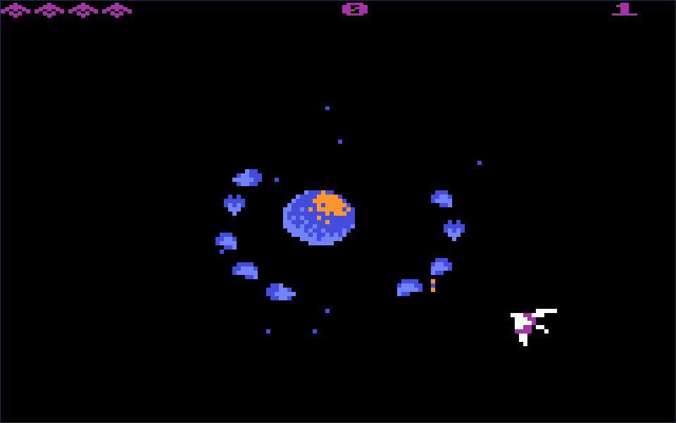

# Gyrus

**[Play Gyrus in your browser](https://tomasmark79.github.io/gyrus/)** — no installation required.

A C++ reconstruction in progress of the Atari 800 XL game supplied as
`GYRUSS.atr`, based on [NixonCpp](https://github.com/tomasmark79/NixonCpp).

**Not a complete game yet.** The executable now shows the recovered title and
an interactive combat preview with controls, incoming waves, formation attacks,
enemy shots, score and sound. Player damage, special enemies and stage progression
are still being reconstructed.
The recovered routines are portable
C++, checked against the original 6502 program, with desktop and WebAssembly builds.



## Current work

- Reproducible ATR/XEX extraction, verified against an Atari800 memory dump.
- Original logo and sprite decoding, with an address-backed graphics report.
- C++ perspective projection and steering with exhaustive original-code comparisons.
- Player input, steering and normal/upgraded projectiles translated and compared
  with original code.
- All ten sound-effect controllers and all eight music streams translated,
  with shared register writes and a POKEY audio model connected to SDL output.
- Original wave decoder and incoming trajectories, shot collision and score routines,
  checked against execution of the original program.
- SDL2 desktop/browser adapter with original artwork, HUD, planets and a documented
  classic Atari RGB palette. Analogue audio and display color remain approximations.

See [port status](docs/port-status.md), [implementation plan](docs/implementation-plan.md),
and [loader evidence](analysis/loader-notes.md). The
[graphics atlas](analysis/graphics-atlas.svg) uses diagnostic colors.

## Build and test

On NixOS, from the project root:

```sh
make debug
./build/builddir-debug/Gyrus
make test
make cross-wasm
```

The scripts select the template's pinned Nix environments. The browser artifact
is `build/builddir-wasm-release/Gyrus.html`; serve its directory over HTTP.
Serve it locally with:

```sh
python3 -m http.server 8785 --bind 127.0.0.1 --directory build/builddir-wasm-release
# Open http://127.0.0.1:8785/Gyrus.html
```

Press Enter to start, arrows/WASD to aim, Space for each shot,
P to pause and Escape to return to the title. Press 2 on the title for two players.
The playable release is hosted on [GitHub Pages](https://tomasmark79.github.io/gyrus/).
Pushes to this repository's `main` branch build and deploy it automatically.
For an offscreen rendering check:

```sh
SDL_VIDEODRIVER=dummy ./build/builddir-debug/Gyrus --frames 3 --capture /tmp/title.bmp
```

## Reverse-engineering tools

```sh
python3 -m venv .venv
.venv/bin/pip install py65==1.2.0
.venv/bin/python tools/reverse/extract.py GYRUSS.atr \
  --disassemble --root 9a94 --root 84ab
.venv/bin/python tools/reverse/polar_oracle.py
.venv/bin/python tools/reverse/audio_oracle.py --verify
.venv/bin/python tools/reverse/player_oracle.py
.venv/bin/python tools/reverse/music_oracle.py --verify
```

py65 and Atari800 are analysis tools only. The C++ port does not embed a CPU
emulator. Memory captures may include system ROM and remain ignored local
analysis artifacts. See the reports for reproduction commands and evidence limits.

## Foundation and attribution

NixonCpp was imported at commit
`8feefd36844009afbc691f562616cf64ce2c7f4f` and renamed with its own script.
Its utility services, Meson/Nix structure, tests and cross-compilation remain.
Gyrus has its own repository at https://github.com/tomasmark79/gyrus.
The only Git remote is `origin`, pointing to that repository. NixonCpp is the
template attribution above, not a configured push destination.

The original NixonCpp copyright and [MIT license](LICENSE.template) are retained
for the reused template. **The game as a whole is not MIT-licensed.**

The original game and recovered graphics, music and other protected material
remain subject to their respective rights holders. No permission for public
distribution of this reconstruction has been documented. Public availability
of this repository or its demo does not establish such permission.
See the [licensing notice](LICENSE) for the scope of these terms.
